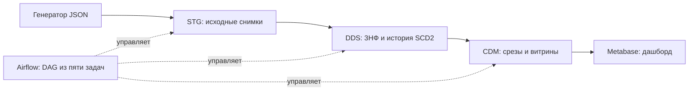

# Лабораторная работа: аналитика заказов интернет-магазина

Готовый учебный стенд: генератор воспроизводимых данных → Airflow → PostgreSQL (STG → DDS → CDM) → Metabase. Предметная область — заказы интернет-магазина. Покупатели и события вымышлены; ФИО в российском порядке, товары преимущественно на русском, цены в рублях.

По умолчанию создаются **100 покупателей, 30 товаров, 5 категорий и 1 000 заказов за 30 дней**. История цен товаров и статусов заказов хранится в DDS; Metabase читает только CDM. Репозиторий создан независимо от [материалов преподавателя](https://github.com/kinomant/ppa-for-da/tree/master/airflow_workshop).

## Быстрый запуск

Нужны Git, Python 3.9 или новее, Docker Engine с Compose либо Docker Desktop в режиме Linux containers. Выделите Docker около 5 ГиБ памяти и несколько гигабайт диска для образов. Первый запуск требует интернета; доступ к Docker должен работать из терминала.

**Linux / macOS:**

```bash
git clone https://github.com/PfLoLexe/ppad-orders-airflow-lab.git
cd ppad-orders-airflow-lab
bash scripts/start.sh
```

В Linux скрипт также поддерживает `sudo -n docker`, если Docker требует sudo без пароля. На macOS запустите Docker Desktop перед выполнением команды.

**Windows, PowerShell:**

```powershell
git clone https://github.com/PfLoLexe/ppad-orders-airflow-lab.git
cd ppad-orders-airflow-lab
powershell.exe -NoProfile -ExecutionPolicy Bypass -File .\scripts\start.ps1
```

Скрипт создаёт данные и пароли, запускает три контейнера, ждёт готовности, выполняет DAG, настраивает дашборд и сверяет результаты с исходными JSON. Linux-вариант проверен на Ubuntu; Windows-скрипт подготовлен, но запуск на Windows отдельно не проверялся. Подробнее: [инструкция Windows](docs/windows.md).

После завершения:

| Сервис | Адрес | Учётная запись |
| --- | --- | --- |
| Airflow | http://localhost:8080 | `admin`; пароль `AIRFLOW_PASSWORD` в `.env` |
| Metabase | http://localhost:3333 | `admin@orders-lab.invalid`; пароль `METABASE_ADMIN_PASSWORD` в `.env` |
| PostgreSQL | `localhost:15432`, база `warehouse` | `warehouse`; пароль `WAREHOUSE_PASSWORD` в `.env` |

В Metabase откройте коллекцию **«Лабораторная — заказы»** и дашборд **«Заказы интернет-магазина»**. На нём 12 карточек и 5 фильтров: срез, начало периода, конец периода, город, категория. Идентификатор дашборда определяется при настройке и записывается в `reports/metabase-artifacts.json`.

`.env` и `private/` создаются локально и исключены из Git. `.env.example` показывает состав настроек; копировать его с паролями `replace` для запуска не нужно. При повторном запуске `configure.py` сохраняет действующие пароли. PostgreSQL создаёт роли и базы только при инициализации пустого тома: правка пароля в `.env` сама по себе не меняет пароль в существующей БД.

## Как устроен стенд



Compose поднимает PostgreSQL, Airflow standalone и Metabase. Лимиты памяти: 512 МиБ, 3 ГиБ и 1,5 ГиБ соответственно. В PostgreSQL раздельные базы `airflow`, `warehouse`, `metabase`; приложения общаются через внутреннюю сеть Compose. BI-пользователь имеет доступ только к CDM.

DAG `orders_pipeline` запускается вручную. Он выполняет загрузку STG, загрузку DDS, проверку DDS, построение CDM и проверку CDM. Ежедневные снимки обрабатываются по порядку. Повторная загрузка уже обработанного набора не меняет данные; повреждённый пакет откатывается транзакцией.

## Объём данных и настройка

Полный запуск с 10 000 заказов выполняется так **в новой копии проекта с отдельными томами**:

```bash
COMPOSE_PROJECT_NAME=orders-lab-large bash scripts/start.sh --orders 10000 --customers 1000
```

Перед этим остановите старый стенд, если он занимает те же локальные порты. Не меняйте набор в уже заполненном warehouse: другой `seed`, период или объём создаёт другой `dataset_id`. Пошаговые команды, параметры, ограничения и пример для PowerShell: **[увеличение числа записей](docs/scaling.md)**.

Только генерация JSON, без запуска контейнеров:

```bash
python3 -m orders_lab.generator --catalog data/reference/catalog.json \
  --seed 42 --start-date 2026-09-01 --days 30 \
  --customers 100 --products 30 --orders 1000
```

Генератор печатает путь к `manifest.json`; этот путь передаётся в `python3 scripts/configure.py --manifest ПУТЬ`. Скрипты полного запуска делают это автоматически. В репозитории есть эталонные снимки стандартного набора; новые наборы создаются локально.

## Обслуживание и проверки

Команды выполняются из корня проекта. Если Docker требует sudo, добавьте `sudo` перед `docker`.

```bash
docker compose ps
docker compose exec -T airflow airflow dags trigger orders_pipeline
docker compose exec -T airflow airflow dags list-runs orders_pipeline -o json
docker compose exec -T airflow airflow dags list-import-errors -o json
docker compose logs --tail 80 airflow
docker compose logs --tail 80 metabase
docker stats --no-stream
```

Дождитесь `success` у нового запуска DAG. Проверки можно повторить отдельно:

```bash
python3 -m unittest discover -s tests -v
docker compose exec -T airflow python /opt/lab/scripts/verify_warehouse.py
python3 scripts/verify_bi.py
```

Проверка warehouse сверяет все срезы с JSON, историю цен, цены покупки, идемпотентность и откат некорректного пакета. Проверка BI выполняет 28 сверок показателей, проверяет устройство дашборда и запрет доступа BI к DDS. Отчёты записываются в `reports/`.

```bash
docker compose stop    # остановить с сохранением данных
docker compose start   # продолжить работу
docker compose down    # удалить контейнеры и сеть, сохранив тома
```

Не добавляйте `-v`, если хотите сохранить БД. Данные находятся в именованных томах; исходные снимки — в `data/snapshots/`. Изменение Python-кода, SQL или DAG не требует сборки образа: файлы монтируются из проекта. Изменение DDL существующей БД требует отдельной миграции; автоматическая инициализация применяется к пустому тому.

## Материалы для четырёх участников

| Участник | Зона работы и инструкция |
| --- | --- |
| 1 | [Генератор, источник, загрузка STG](docs/participants/01-source-stg.md) |
| 2 | [Проектирование DDS в 3НФ, перенос из STG, SCD2](docs/participants/02-dds.md) |
| 3 | [CDM из DDS, метрики, BI и фильтры](docs/participants/03-cdm-bi.md) |
| 4 | [Docker Compose, запуск, подключения, обслуживание](docs/participants/04-environment.md) |

Начните с [общей методической инструкции](docs/participants/README.md). В каждой роли есть словарь терминов с примерами, схема взаимодействия, пошаговые действия, SQL для проверки, диагностика и вопросы для защиты. Общие документы:

- [Предметная область и определения метрик](docs/domain.md).
- [Модель БД, связи и история](docs/model.md).
- [Согласованный каталог, учебные цены и источники](docs/catalog-proposal.md).
- [Решения и соответствие известным требованиям](docs/decisions.md).
- [Проверенные результаты и сценарий защиты](reports/verification.md).

В `reports/` сохранены результаты эталонного запуска на 1 000 заказов и отдельной проверки на 10 000 заказов за 12 дней. Они описывают проверенный запуск, а не текущее состояние нового стенда. Для локального архива без секретов выполните `python3 scripts/package.py`; архив создаётся рядом с папкой проекта. Томов БД в архиве нет — данные воспроизводятся генератором и DAG.
