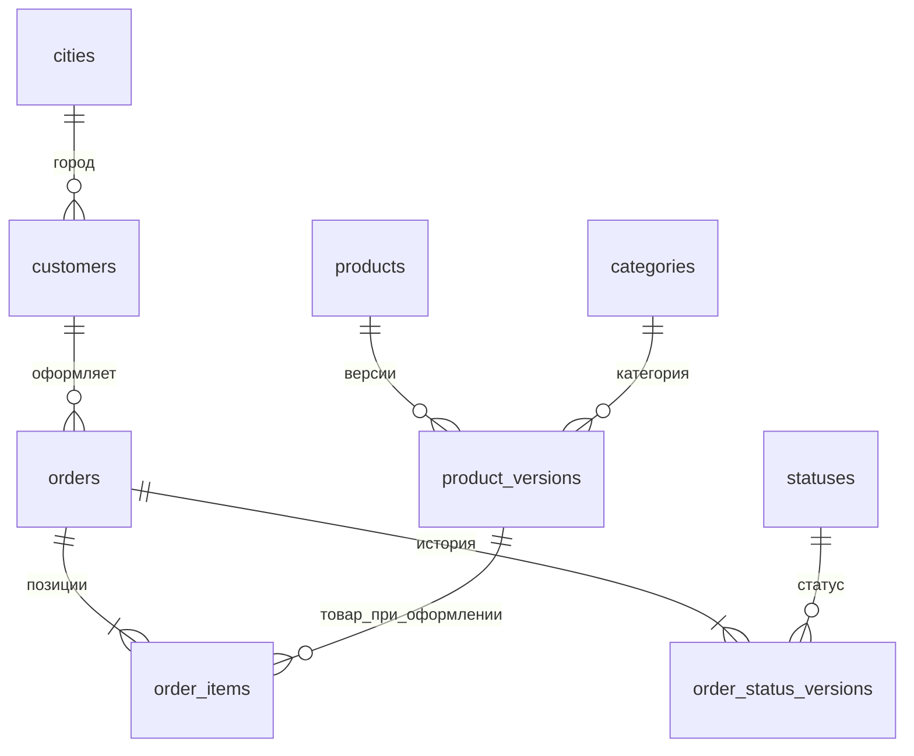

# Модель PostgreSQL

DDL: [`sql/01_warehouse.sql`](../sql/01_warehouse.sql). Загрузка: [`orders_lab/pipeline.py`](../orders_lab/pipeline.py). Витрины: [`sql/02_cdm.sql`](../sql/02_cdm.sql).

## DDS и третья нормальная форма

Города, категории и статусы вынесены в справочники. Покупатель хранит `city_id`, а не название города. Заказ хранит идентификатор покупателя и дату оформления, без копирования ФИО и города. Позиция хранит количество, цену покупки и ссылку на товарную версию. Сумма заказа не дублируется в DDS: её рассчитывают из позиций. Название категории не копируется в версии товара.

Стабильная идентичность товара находится в `products`, изменяемые атрибуты — в `product_versions`. Поля версии функционально зависят от ключа версии; атрибуты категории и покупателя вынесены в свои таблицы. Текущий статус вычисляется из истории, а не дублируется в заказе. Это устраняет транзитивные зависимости и несогласованность при обновлениях в границах данной модели.

Цена покупки в позиции — отдельный факт сделки. Она не обязана равняться каталожной цене, например при будущей скидке; в текущем генераторе они равны на момент оформления.

## SCD2

Интервал версии: `[valid_from, valid_to)`. У текущей версии `valid_to IS NULL`. Частичный уникальный индекс допускает одну текущую версию на сущность; проверка качества выявляет пересечения интервалов. Представление `current_products` выводит признак `is_current` без хранения дублирующего флага.

При изменении атрибутов товара текущий интервал закрывается временем изменения и вставляется новая версия. Новый статус заказа обрабатывается аналогично. Изменения происходят в одной транзакции на снимок. Внешние ключи связывают позиции с существующей исторической версией товара.

При построении среза конца дня выбирается статус с `valid_from < начало следующего дня` и `valid_to >= начало следующего дня` либо без конца интервала. Поэтому даже после загрузки будущих дней можно восстановить предыдущий срез.

## Повторы и ошибки

`ops.dataset` фиксирует единственный набор, `ops.batches` — контрольные суммы и завершённые этапы. `stg.snapshots` сохраняет исходный JSON. Этап DDS читает STG и проверяет связи, суммы и времена; CDM читает только DDS. SHA-256 файла проверяется до загрузки. Уже обработанный этап пропускается. Подмена загруженного файла, другой набор или недопустимый переход статуса приводят к ошибке.

Каждый снимок коммитится отдельно. При ошибке следующие снимки не обрабатываются; уже успешно загруженные дни сохраняются. После устранения причины повтор продолжает с незавершённого дня. Изменение опубликованного снимка требует отдельной процедуры исправления; автоматической перезаписи нет.

## Витрины

- `order_snapshots`: один заказ на дату среза, сумма, статус, покупатель, даты оформления и доставки.
- `order_item_snapshots`: одна позиция на дату среза, товар и категория на момент оформления, количество и сумма.
- `daily_orders`: дата среза × дата оформления × город.
- `daily_sales`: дата среза × дата доставки × город × категория.

Денормализация CDM нужна для удобства BI; требование 3НФ применяется к DDS. BI-пользователь имеет `SELECT` только в схеме CDM.
