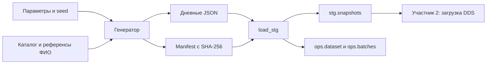

# Участник 1: генератор данных и слой STG

Ваша часть — подготовить воспроизводимый источник заказов и сохранить дневные снимки в STG. На выходе участник 2 получает исходные документы, их контрольные суммы и описание правил, по которым меняются товары и заказы.

Сначала ознакомьтесь с [общим порядком работы](README.md) и [предметной областью](../domain.md). Стенд запускает участник 4; команды ниже выполняются из корня проекта. Для SQL откройте psql, как описано в общем порядке работы.

## Методичка терминов

| Термин | Объяснение | Пример в проекте |
| --- | --- | --- |
| Источник данных | Система или файл, из которого начинаются загрузки | Учебный генератор вместо реального магазина |
| Синтетические данные | Вымышленные записи, созданные по заданным правилам | Покупатели, заказы и их статусы |
| Псевдослучайность | Последовательность чисел, определяемая алгоритмом и начальным состоянием | Выбор покупателя, товаров и времени заказа |
| Seed | Число, задающее начальное состояние генератора | `--seed 42` даёт воспроизводимый набор при том же каталоге и остальных параметрах |
| Сущность | Объект предметной области с собственной идентичностью | Покупатель, товар, заказ |
| Идентификатор | Значение, отличающее одну сущность от другой | `order.id`; одинаковое ФИО не означает одинакового покупателя |
| Позиция заказа | Отдельная строка товара внутри заказа | `line_no`, `product_id`, `quantity`, `unit_price` |
| JSON | Текстовый формат объектов, массивов и значений | Один файл со списками товаров и заказов |
| Сериализация | Превращение структуры программы в представление для хранения | Запись Python-словарей в JSON |
| Снимок, snapshot | Состояние источника на выбранный момент | Все видимые заказы к концу 15 сентября |
| Полный накопительный снимок | Файл включает ранее появившиеся и новые заказы | Заказ из первого дня встречается и в следующих файлах |
| Контракт данных | Согласованные поля, типы, связи и правила изменения | Цена — строка, товар позиции должен существовать в `products` |
| Manifest, манифест | Файл с описанием набора и перечнем снимков | `manifest.json` с датами и SHA-256 |
| `dataset_id` | Идентификатор конкретного набора | Зависит от параметров и содержимого каталога |
| SHA-256 | Функция, вычисляющая контрольную сумму содержимого | Изменённый JSON перестанет соответствовать manifest |
| Валидация | Проверка соответствия контракту | Сумма заказа равна сумме позиций |
| STG, staging | Слой хранения входных документов | `stg.snapshots` хранит JSON каждого дня |
| `jsonb` | Тип PostgreSQL для хранения и обработки JSON | Поле `payload`; форматирование исходного файла в нём не сохраняется |
| Пакет, batch | Единица обработки данных | Один дневной снимок |
| Идемпотентность | Повтор операции сохраняет уже достигнутый результат | Повтор STG того же набора не добавляет снимки-дубликаты |

SHA-256 обнаруживает расхождение файла с manifest, но не доказывает подлинность источника: здесь manifest создаёт тот же учебный генератор. Исходный текстовый файл остаётся в `data/snapshots/`; STG хранит его разобранное содержимое в `jsonb` и контрольную сумму исходных байтов.

## Схема своей части



В генераторе нет запросов к сети или БД. Он использует согласованный каталог и локальные списки имён. Загрузчик STG проверяет файлы и метаданные, сохраняет документы; бизнес-проверки выполняются при переносе в DDS.

## Файлы, которые нужно разобрать

| Файл | На что обратить внимание |
| --- | --- |
| [generator.py](../../orders_lab/generator.py) | `Config`, `product_versions`, `make_dataset`, `write_dataset` |
| [catalog.json](../../data/reference/catalog.json) | Категории, товары, рублёвые цены, `approval_status=approved` |
| [Источники каталога](../catalog-proposal.md) | Какие цены взяты за ориентир и какие являются условными учебными |
| `data/reference/*_source.json` | Сохранённые источники имён и фамилий |
| [validation.py](../../orders_lab/validation.py) | `validate_snapshot`, уникальность, связи, деньги и время |
| [pipeline.py](../../orders_lab/pipeline.py) | `entries` проверяет manifest; `load_stg` сохраняет данные |
| [Тесты генератора](../../tests/test_generator.py) | Воспроизводимость, статусы, история и ошибочные данные |

## Шаг 1. Разобрать правила генерации

Стандартные параметры: 100 покупателей, 30 товаров, пять категорий, 1 000 заказов за 30 дней с 1 сентября 2026 года. `--orders` задаёт количество за весь период. В каждом заказе от одной до четырёх разных позиций, в каждой — от одной до трёх единиц товара.

Покупатель получает стабильный ID и ФИО в порядке «фамилия имя отчество»; формы согласованы по полу. Цена позиции фиксируется по версии товара на время оформления. Первый товар меняет цену дважды, чтобы показать историю. Заказ проходит `created → paid → shipped → delivered`; отмена возможна из `created` или `paid`.

Генератор создаёт события после оформления и показывает только события, наступившие до границы снимка. Поздний заказ может не успеть доставиться к последнему дню. Уменьшение периода не гарантирует завершение всех заказов.

## Шаг 2. Создать или воспроизвести файлы

Для стандартного набора:

```bash
python3 -m orders_lab.generator --catalog data/reference/catalog.json
python3 -m unittest discover -s tests -v
```

Первая команда печатает путь к manifest. Вторая проверяет генератор и настройку проекта. При одинаковых параметрах и каталоге файлы и контрольные суммы воспроизводятся. Не удаляйте уже выбранный набор и не меняйте его JSON для эксперимента с работающей БД. Другой seed или объём испытывайте в отдельной копии по [инструкции](../scaling.md).

## Шаг 3. Прочитать контракт снимка

| Раздел / поле | Содержание | Что должен знать загрузчик DDS |
| --- | --- | --- |
| `meta.schema_version` | Версия формата, сейчас `1` | Другой формат отклоняется |
| `meta.dataset_id` | ID набора | Должен совпадать с manifest |
| `meta.snapshot_date` | День наблюдения | Должен совпадать с датой записи manifest |
| `meta.observed_before` | Начало следующих суток с часовым поясом | Все видимые события строго раньше этой границы |
| `meta.currency`, `meta.synthetic` | `RUB`, `true` | Данные рублёвые и учебные |
| `categories` | `id`, `name` | Категории стабильны |
| `customers` | `id`, `last_name`, `first_name`, `patronymic`, `city` | Покупатели в этом наборе не меняются |
| `products` | `id`, `name`, `category_id`, `catalog_price`, `updated_at` | Атрибуты и время версии товара могут измениться |
| `orders` | `id`, `customer_id`, `created_at`, `status`, `status_updated_at`, `total_amount`, `items` | Статус меняется; состав и цена покупки сохраняются |
| `orders.items` | `line_no`, `product_id`, `quantity`, `unit_price` | Номер позиции уникален внутри заказа |

Для снимка 15 сентября граница — `2026-09-16T00:00:00+03:00`. Событие ровно в эту полночь относится к следующему снимку. Повтор заказа в нескольких днях означает наблюдение его состояния, а не новую продажу.

Учебный пример расчёта: две единицы по `69.00` и одна по `149.00` дают сумму `287.00`. В JSON деньги представлены десятичными строками, в Python расчёт использует `Decimal`; это позволяет сохранить точность до копеек.

Откройте, например, [первый снимок стандартного набора](../../data/snapshots/orders-3db6d74e59523514/2026-09-01.json). Найдите заказ 1, пересчитайте сумму, затем найдите тот же ID в следующих днях и сравните статус. При другом наборе используйте папку из собственного manifest.

## Шаг 4. Проверить загрузку STG

Если контейнеры готовы и `.env` уже указывает на нужный manifest:

```bash
docker compose exec -T airflow python -m orders_lab.pipeline stg
docker compose exec postgres psql -U postgres -d warehouse
```

В psql:

```sql
SELECT dataset_id FROM ops.dataset;

SELECT snapshot_date, jsonb_array_length(payload->'orders') AS orders_count,
       source_sha256
FROM stg.snapshots
ORDER BY snapshot_date;

SELECT snapshot_date, stg_loaded_at, dds_loaded_at, cdm_loaded_at
FROM ops.batches ORDER BY snapshot_date;
```

На полностью загруженном стандартном наборе будет 30 снимков; последний содержит 1 000 заказов. Если пока выполнен только STG, поля `dds_loaded_at` и `cdm_loaded_at` остаются пустыми. На стенде, уже запущенном полным скриптом, они заполнены.

Повторите команду STG и запрос. Число снимков не увеличится. Загрузчик отвергает другой `dataset_id` в том же warehouse и попытку изменить контрольную сумму уже загруженного дня.

## Передача участнику 2

Передайте выбранный manifest, описание полей, последовательность дней, разрешённые статусы и правила неизменяемых данных. Уточните, что STG может хранить документ с бизнес-ошибкой: вход сохранён, а DDS должен отклонить его при проверке. Дневные снимки нужно обрабатывать с первого дня по порядку — один последний файл не содержит всей истории переходов.

## Ошибки и диагностика

| Симптом | Проверка и действие |
| --- | --- |
| Неверная контрольная сумма | Сравнить файл и manifest; восстановить исходные файлы воспроизводимого набора, не подгонять checksum вручную |
| Метаданные не совпадают с manifest | Проверить, не смешаны ли файлы разных наборов или дат |
| Хранилище содержит другой набор | Создать отдельный стенд; порядок — в `docs/scaling.md` |
| Генератор отклоняет каталог | Проверить статус `approved`, число товаров и формат цен |
| Ошибка `No module named psycopg2` на хосте | Загрузчик должен запускаться через `docker compose exec ... airflow` |

## Готовность и вопросы для защиты

Ваша часть разобрана, если вы можете найти источник любого поля, воспроизвести набор, показать manifest и STG, объяснить проверку checksum и передачу данных в DDS.

Подготовьте ответы:

1. Что меняется при другом seed и почему ID набора тоже меняется?
2. Почему 30 файлов с одним заказом не означают 30 заказов?
3. Чем проверка суммы отличается от проверки SHA-256?
4. Почему исходный JSON сохраняется даже при ошибке бизнес-данных?
5. Зачем цена покупки хранится отдельно от текущей каталожной цены?
