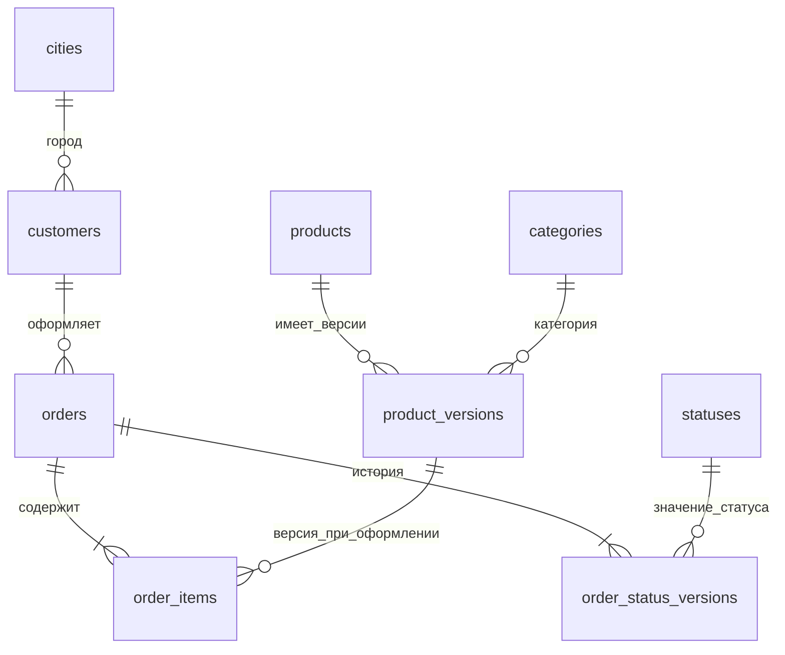
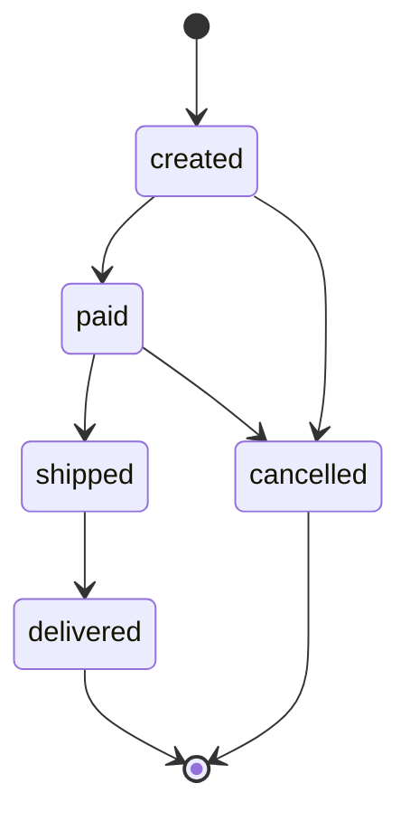

# Участник 2: проектирование DDS и загрузка истории

Ваша часть — превратить исходные JSON в связанную детальную модель PostgreSQL, сохранить историю товаров и статусов, проверить целостность. Участник 3 должен получить DDS, из которого можно восстановить состояние заказов на прошлую дату и построить витрины.

Перед началом прочитайте [общую инструкцию](README.md). Участник 1 должен выбрать набор и загрузить STG; участник 4 — поднять окружение. Если полный скрипт запуска уже завершился, все слои заполнены и шаги ниже демонстрируют существующие данные и повтор загрузки.

## Методичка терминов

| Термин | Объяснение | Пример в проекте |
| --- | --- | --- |
| DDS | Слой согласованных детальных данных | Схема `dds` в базе `warehouse` |
| Реляционная модель | Представление данных через таблицы, строки и связи | Заказ связан с покупателем через `customer_id` |
| Схема PostgreSQL | Пространство имён внутри БД | `dds.orders` и `cdm.order_snapshots` находятся в разных схемах |
| DDL | SQL для создания структуры | `CREATE TABLE`, `CREATE INDEX` в `01_warehouse.sql` |
| DML | SQL для работы со строками | `INSERT`, `UPDATE`, `SELECT` в загрузчике |
| Первичный ключ, PK | Поля, однозначно определяющие строку | `order_id` в `orders` |
| Составной ключ | Ключ из нескольких полей | `(order_id, line_no)` в `order_items` |
| Внешний ключ, FK | Ссылка на существующую строку другой таблицы | `orders.customer_id → customers.customer_id` |
| Ссылочная целостность | Согласованность таких ссылок | Позиция не может ссылаться на отсутствующую товарную версию |
| Бизнес-ключ | ID сущности из источника | `product_id` сохраняется между версиями |
| Суррогатный ключ | Технический ID, созданный хранилищем | `product_version_id` различает версии одного товара |
| Функциональная зависимость | Одно значение или набор значений определяет другие | `customer_id` определяет ФИО и `city_id` покупателя |
| Нормализация | Разделение данных по зависимостям для уменьшения противоречий | Название города хранится в справочнике |
| 3НФ | Третья нормальная форма; в нашей модели описательные поля не дублируют сведения о других сущностях | ФИО находится в покупателе, заказ хранит только ссылку |
| Справочник | Таблица значений, используемых другими сущностями | `cities`, `categories`, `statuses` |
| SCD2 | Хранение изменений отдельными версиями с интервалами действия | Три строки цены товара 1 |
| Полуоткрытый интервал | Начало включено, конец исключён | `[valid_from, valid_to)` |
| `NULL` | Отсутствующее значение | `valid_to IS NULL` означает незакрытую версию |
| Ограничение | Правило, проверяемое самой БД | `CHECK (quantity > 0)`, `UNIQUE` |
| Транзакция | Группа изменений, фиксируемых или откатываемых вместе | Загрузка одного дня DDS |
| Commit / rollback | Подтверждение изменений / отмена незавершённой транзакции | День с ошибкой не фиксируется |
| Индекс | Структура для поиска или ограничения уникальности | Одна незакрытая версия товара по частичному уникальному индексу |
| Advisory lock | Согласованная блокировка между операциями приложения | Загрузчики используют один ключ блокировки в PostgreSQL |

SCD2 здесь применяется к товарам и статусам заказов. Покупатели, категории, уже созданные заказы и их позиции в рамках набора считаются неизменяемыми. Изменение этих записей отклоняется; историю адресов покупателей или редактирование состава заказа эта модель не реализует.

## Модель и связи



Линия «один ко многим» означает, например, что у покупателя может быть много заказов, но у одного заказа в этой модели ровно один покупатель. Наличие хотя бы одной позиции заказа проверяет загрузчик и проверка качества; один внешний ключ сам по себе этого не гарантирует.

| Таблица DDS | Ключ | Содержание |
| --- | --- | --- |
| `cities` | `city_id` | Уникальные названия городов |
| `customers` | `customer_id` | ФИО и ссылка на город |
| `categories` | `category_id` | Названия категорий |
| `products` | `product_id` | Стабильная идентичность товара |
| `product_versions` | `product_version_id` | Название, категория, цена, интервал версии товара |
| `statuses` | `status_code` | Коды и русские названия статусов |
| `orders` | `order_id` | Покупатель и время оформления |
| `order_status_versions` | `order_status_version_id` | Статус заказа и его интервал |
| `order_items` | `(order_id, line_no)` | Версия товара, количество, цена покупки |

Изучите [DDL](../../sql/01_warehouse.sql), [загрузчик](../../orders_lab/pipeline.py), [описание модели](../model.md) и [проверку warehouse](../../scripts/verify_warehouse.py). Структура создаётся участником 4 при инициализации пустой БД. Повторное выполнение DDL не является миграцией уже работающего хранилища.

## Шаг 1. Объяснить нормализацию на заказе

**Первая нормальная форма.** В DDS каждая позиция становится отдельной строкой. В `orders` нет JSON-массива товаров. ФИО разделено на фамилию, имя и отчество, которые используются как отдельные атрибуты.

**Вторая нормальная форма.** В `order_items` ключ состоит из номера заказа и номера позиции. Количество и цена покупки относятся к конкретной позиции. ФИО покупателя и дата заказа не копируются в каждую позицию: они относятся к заказу или покупателю и находятся в своих таблицах.

**Третья нормальная форма.** Покупатель хранит `city_id`; название города хранится в `cities`. Заказ хранит `customer_id`; ФИО находится в `customers`. Версия товара хранит `category_id`; название категории находится в `categories`. Так сведения о связанных сущностях не приходится обновлять во множестве строк.

Сумма заказа не дублируется в `dds.orders`: её получают из `sum(quantity * unit_price)`. Текущий статус находится через незакрытую версию истории. `unit_price` в позиции — самостоятельный факт сделки; в текущем генераторе он равен каталожной цене при оформлении, но его смысл отличается от текущей цены каталога.

## Шаг 2. Разобрать SCD2

В стандартном наборе товар 1 имеет три цены:

| Начало версии по Москве | Цена | Конец версии |
| --- | --- | --- |
| 1 сентября 2026 | 69,00 ₽ | Начало 11 сентября |
| 11 сентября 2026 | 75,90 ₽ | Начало 21 сентября |
| 21 сентября 2026 | 65,55 ₽ | `NULL` |

Даты и цены относятся к стандартным параметрам и утверждённому каталогу. При другом периоде или каталоге проверяйте свой источник.

При изменении товара загрузчик закрывает прежнюю версию временем изменения и вставляет новую. На границе двух версий действует новая: условие выбора на момент `t` — `valid_from <= t` и `valid_to > t` либо конец отсутствует. Для каждого товара допустима одна незакрытая версия.

Позиция заказа ссылается на версию товара **на момент оформления**. Заказ 1 поэтому сохраняет цену 69,00 ₽ после изменения каталога. Связь только с текущей версией исказила бы историю сделки.

Для статусов используется тот же принцип интервалов:



Переход назад из `delivered` в `created` запрещён. Когда первый доступный снимок заказа уже имеет `paid` или `delivered`, загрузчик не может восстановить пропущенное начало и отклоняет его. В генераторе переходы одного заказа разнесены по дням; произвольный источник с несколькими переходами за день потребовал бы другого формата истории.

## Шаг 3. Проследить загрузку одного дня

1. `load_dds` читает manifest по датам и проверяет, что STG для дня существует.
2. По `ops.batches` он пропускает уже завершённый день и контролирует хронологию новых дней.
3. Читает JSON из `stg.snapshots`, затем `validate_snapshot` проверяет поля, ссылки, суммы и время.
4. Сверяет справочники и покупателей; создаёт или закрывает товарные версии.
5. Сверяет неизменяемые поля заказов, обрабатывает переходы статусов и позиции.
6. Проверяет состав и сумму каждого заказа; отмечает завершение дня и делает commit.

Изменения одного снимка и отметка `dds_loaded_at` фиксируются вместе. Если ошибка возникла после обновления товара, новый товар и прочие изменения этого дня откатываются. Ранее успешно обработанные дни остаются в БД. Служебные последовательности ID могут иметь пропуски; наличие пропуска не означает потерю строки.

## Шаг 4. Выполнить загрузку и проверки

```bash
docker compose exec -T airflow python -m orders_lab.pipeline dds
docker compose exec -T airflow python -m orders_lab.pipeline check-dds
docker compose exec postgres psql -U postgres -d warehouse
```

В psql задайте отображение времени и посмотрите связи:

```sql
SET TIME ZONE 'Europe/Moscow';
\dt dds.*
\d dds.order_items

SELECT product_id, product_version_id, product_name, catalog_price,
       valid_from, valid_to
FROM dds.product_versions WHERE product_id=1 ORDER BY valid_from;

SELECT i.order_id, i.line_no, i.unit_price, v.catalog_price, v.valid_from
FROM dds.order_items i
JOIN dds.product_versions v USING (product_version_id)
WHERE i.order_id IN (1,2) AND v.product_id=1
ORDER BY i.order_id, i.line_no;

SELECT order_id, status_code, valid_from, valid_to
FROM dds.order_status_versions WHERE order_id=1 ORDER BY valid_from;
```

Первый запрос показывает версии; второй — цену покупки и версию, выбранную при оформлении; третий — историю одного заказа. `SET TIME ZONE` меняет только отображение и интерпретацию времени в текущей сессии.

Контроль незакрытых версий:

```sql
SELECT product_id, count(*)
FROM dds.product_versions WHERE valid_to IS NULL
GROUP BY product_id HAVING count(*) <> 1;

SELECT order_id, sum(quantity * unit_price) AS order_amount
FROM dds.order_items GROUP BY order_id ORDER BY order_id LIMIT 10;
```

Первый запрос не должен возвращать строк среди товаров с незакрытой версией; отсутствие версии у товара им отдельно не выявляется. Полную проверку интервалов и заказов выполняет `check-dds`.

После заполнения CDM запустите расширенную сверку:

```bash
docker compose exec -T airflow python /opt/lab/scripts/verify_warehouse.py
```

Она сравнивает срезы с JSON, историю цен и цену покупки, повторяет загрузки и проверяет откат намеренно ошибочного пакета. Данные таблиц после этой проверки сохраняются; отчёт записывается в `reports/warehouse-verification.json`.

## Передача участнику 3

Передайте ER-схему, ключи, значения статусов, единицы денег и времени, смысл `valid_from` и `valid_to`. Объясните различие между выбором версии **в момент времени** и срезом **строго до начала следующих суток**. Для CDM на конец дня нужно взять последнее состояние до границы, даже если загруженные позднее дни уже закрыли старую версию.

## Ошибки и действия

| Симптом | Что проверить |
| --- | --- |
| `Сначала требуется STG` | Выбранный набор и отметки STG; выполнить загрузку STG |
| Недопустимый переход статуса | Историю заказа и порядок файлов; нельзя просто заменить статус в БД для обхода проверки |
| Нет версии товара на момент оформления | Время создания заказа и интервалы товара; наличие ранних снимков |
| Изменение неизменяемой записи | Сравнить старые сведения с источником; текущая модель не поддерживает такое изменение |
| Несовпадение позиций и суммы | Проверить `line_no`, количество и цены в JSON и DDS |

При ошибке смотрите незавершённый день в `ops.batches`. Восстановите корректные исходники своего набора и повторите загрузку. Изменение уже опубликованного снимка не поддерживает автоматическую перезапись: исправления требуют отдельной согласованной процедуры.

## Готовность и вопросы для защиты

Покажите структуру таблиц, внешние ключи, три версии товара, сохранённую цену покупки и историю заказа. Объясните, какие правила проверяет PostgreSQL, а какие — Python.

1. Чем `product_id` отличается от `product_version_id`?
2. Какие зависимости убирает третья нормальная форма?
3. Почему одновременно хранятся `catalog_price` и `unit_price`?
4. Что произойдёт на границе двух версий?
5. Как откатывается один день и почему уже загруженные дни остаются?
6. Почему последнего JSON недостаточно для восстановления всех статусов?
