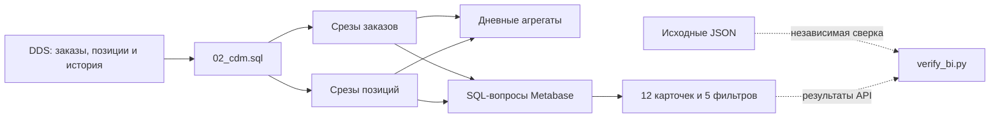

# Участник 3: CDM, расчёт показателей и дашборд

Ваша часть — получить аналитические срезы из DDS, определить смысл каждого показателя, построить дашборд Metabase и сверить его с данными. На защите вы объясняете, из каких заказов получилась каждая цифра и как её меняют фильтры.

Начните с [общей инструкции](README.md) и [предметной области](../domain.md). DDS должен быть загружен и проверен участником 2. Окружение и локальные адреса предоставляет участник 4. На стенде после полного запуска CDM и дашборд уже готовы; повторные команды используют тот же набор.

## Методичка терминов

| Термин | Объяснение | Пример в проекте |
| --- | --- | --- |
| CDM | Слой данных, подготовленных для аналитики | Срезы и агрегаты схемы `cdm` |
| Витрина | Таблица или набор таблиц для определённого анализа | `daily_sales` для продаж по дням, городам и категориям |
| BI, Business Intelligence | Анализ данных с помощью запросов и визуализаций | Metabase |
| Метрика | Показатель с определённым правилом расчёта | Доставленные продажи в рублях |
| Агрегация | Объединение строк в итоговые значения | `sum(line_amount)` по категории |
| Измерение | Признак, по которому группируют или фильтруют факты | Город, категория, дата |
| Факт | Измеряемое событие или значение | Количество товара в позиции, цена покупки |
| Гранулярность | Что представляет одна строка | Один заказ на одну дату среза |
| Денормализация | Добавление связанных описательных полей в аналитические строки | ФИО и название города в `order_snapshots` |
| Срез, as of | Состояние на выбранный момент | Статус заказа на конец 15 сентября |
| Когорта | Группа объектов, выбранная по общему условию | Заказы, оформленные в выбранном периоде |
| Фильтр | Условие выбора данных | Город «Москва» |
| Дашборд | Экран с несколькими связанными показателями и графиками | «Заказы интернет-магазина» |
| Вопрос, карточка | Сохранённый запрос и способ отображения результата в Metabase | «Средний доставленный чек, ₽» |
| CTE | Именованный промежуточный результат внутри SQL через `WITH` | `selected_items`, `selected` |
| JOIN | Объединение строк по условию связи | Заказы и их позиции |
| `GROUP BY` | Группировка строк перед расчётом агрегатов | Продажи по категориям |
| `COALESCE` | Выбор первого непустого значения | Ноль вместо пустой суммы |
| `NULLIF` | Возврат `NULL`, если два значения равны | Защита знаменателя от нуля |
| Bootstrap | Первоначальная программная настройка | Скрипт создаёт подключение, коллекцию и дашборд |
| API | Программный интерфейс сервиса | Скрипт создаёт и проверяет вопросы Metabase через HTTP |
| Read-only | Разрешение чтения без изменения данных | `bi_reader` получает `SELECT` на CDM |

Нормализация DDS помогает хранить согласованные детали. Денормализация CDM позволяет читать ФИО, город, сумму и статус без повторения всей цепочки соединений. Это разные задачи слоёв; требование 3НФ применяется к DDS.

## Схема своей части



`sql/02_cdm.sql` читает исключительно DDS. Дашборд в текущей реализации использует срезы заказов и позиций: они позволяют корректно ограничивать категории внутри корзины. Таблицы дневных агрегатов тоже создаются, но готовые вопросы дашборда непосредственно их не используют.

## Файлы и гранулярность

| Файл | Назначение |
| --- | --- |
| [02_cdm.sql](../../sql/02_cdm.sql) | Построение четырёх таблиц CDM для каждого дня |
| [pipeline.py](../../orders_lab/pipeline.py) | `load_cdm` и `quality('cdm')` |
| [metabase_bootstrap.py](../../scripts/metabase_bootstrap.py) | Общий CTE, запросы, настройка вопросов и фильтров |
| [verify_bi.py](../../scripts/verify_bi.py) | Независимый расчёт из JSON и сверка результатов API |
| `reports/metabase-artifacts.json` | ID подключения, коллекции, дашборда и вопросов после настройки |
| `reports/metabase-results.json`, `reports/bi-verification.json` | Результаты выполнения и проверок |

| Таблица CDM | Одна строка | Основные значения |
| --- | --- | --- |
| `order_snapshots` | Дата среза × заказ | Сумма, ФИО, город, статус, даты, срок доставки |
| `order_item_snapshots` | Дата среза × заказ × номер позиции | Товар и категория при оформлении, количество, цена, сумма |
| `daily_orders` | Дата среза × дата оформления × город | Число заказов, оформленная сумма, число отмен |
| `daily_sales` | Дата среза × дата доставки × город × категория | Проданные единицы и доставленная сумма |

Одно событие встречается в нескольких исторических срезах. Перед расчётом выбирайте одну `snapshot_date`; сумма по всем срезам посчитает один заказ многократно.

## Шаг 1. Восстановить состояние на конец дня

Для дня `D` граница — начало следующего дня по Москве. В срез попадают заказы, оформленные строго раньше границы. Версия статуса должна иметь `valid_from < граница` и `valid_to >= граница` либо отсутствующий конец.

Почему конец включается в условие сравнения? Срез описывает состояние **непосредственно перед границей**. Если старая версия закрылась ровно в следующую полночь, она ещё действовала в конце предыдущего дня. Новая версия с началом в эту полночь в предыдущий срез не входит.

При выборе товарной версии для позиции уже использован момент оформления. Поэтому CDM получает категорию и товар из сохранённой ссылки позиции; изменение цены после продажи не пересчитывает сумму старого заказа.

## Шаг 2. Зафиксировать определения метрик

Сначала выбираются срез, город и категория. Фильтр периода затем применяется к соответствующей дате. Начальная и конечная даты включаются в период.

| Показатель | Расчёт | Дата периода |
| --- | --- | --- |
| Количество заказов | Число заказов после фильтров | Оформление |
| Оформленная сумма | Сумма выбранных позиций всех оформленных заказов, включая отменённые | Оформление |
| Доставленные продажи | Сумма выбранных позиций заказов со статусом `delivered` на срезе | Доставка |
| Средний доставленный чек | Доставленная сумма / число доставленных заказов после фильтров | Доставка |
| Доля отмен | Отменённые заказы / все заказы выбранной когорты × 100 % | Оформление |
| Средний срок доставки | Среднее число часов от оформления до перехода в `delivered` | Доставка |
| Топ товаров и категории | Сумма доставленных позиций и проданных единиц | Доставка |

Пустой срез означает последний загруженный день; пустые остальные фильтры снимают соответствующее ограничение. Если нет заказов, количество и суммы равны нулю, а доля отмен и средние показатели пустые. Отсутствие доставок не означает нулевое время доставки.

При категории считаются только её позиции, но заказ учитывается один раз, если содержит хотя бы одну такую позицию. Средний чек тогда относится к выбранной части корзины. Категория определяется по товарной версии при оформлении.

Учебный пример: заказ содержит канцелярию на 200 ₽ и освещение на 800 ₽. Без фильтра его сумма — 1 000 ₽. При категории «Канцелярия» в сумму входит 200 ₽, а количество заказов остаётся равным одному. Такое поведение должно быть объяснено пользователю показателя.

## Шаг 3. Избежать ошибок при JOIN

В `selected_items` выбираются позиции одной даты и нужной категории. Их суммы группируются по заказу. Только после этого `selected` соединяет полученную сумму с одной строкой заказа и применяет город.

При прямом соединении заказа с позициями строка заказа повторяется. Учебный пример: один заказ на 100 ₽ имеет одну позицию, другой на 300 ₽ — три. `avg(order_amount)` после такого JOIN даст `(100 + 300 + 300 + 300) / 4 = 250 ₽`, хотя правильный средний чек по двум заказам — 200 ₽. Прежде чем агрегировать, проверьте гранулярность результата.

## Шаг 4. Построить CDM и проверить SQL

```bash
docker compose exec -T airflow python -m orders_lab.pipeline cdm
docker compose exec -T airflow python -m orders_lab.pipeline check-cdm
docker compose exec postgres psql -U postgres -d warehouse
```

Последние два шага требуют уже построенного DDS. В psql:

```sql
SELECT snapshot_date, count(*) AS orders
FROM cdm.order_snapshots GROUP BY snapshot_date ORDER BY snapshot_date;

SELECT count(*) AS orders,
       coalesce(sum(order_amount),0) AS ordered_rub,
       count(*) FILTER (WHERE status_code='delivered') AS delivered_orders,
       coalesce(sum(order_amount) FILTER (WHERE status_code='delivered'),0) AS sales_rub,
       round(avg(order_amount) FILTER (WHERE status_code='delivered'),2) AS average_check_rub,
       round(100.0 * count(*) FILTER (WHERE status_code='cancelled')
             / nullif(count(*),0),2) AS cancelled_percent,
       round(avg(delivery_hours) FILTER (WHERE status_code='delivered'),2) AS delivery_hours
FROM cdm.order_snapshots
WHERE snapshot_date=(SELECT max(snapshot_date) FROM cdm.order_snapshots);
```

Этот запрос сверяет общий последний срез без фильтра периода, города и категории. Для стандартного набора на 30 сентября: 1 000 заказов; оформленная сумма 902 647,95 ₽; 700 доставленных заказов; продажи 626 442,90 ₽; чек 894,92 ₽; отмены 14,80 %; срок 105,89 ч. При других параметрах сверяйтесь с собственным отчётом, а не с этими числами.

Проверка продаж по категориям:

```sql
SELECT i.category_name, sum(i.quantity) AS units, sum(i.line_amount) AS sales_rub
FROM cdm.order_snapshots o
JOIN cdm.order_item_snapshots i USING (snapshot_date, order_id)
WHERE o.snapshot_date=(SELECT max(snapshot_date) FROM cdm.order_snapshots)
  AND o.status_code='delivered'
GROUP BY i.category_name ORDER BY sales_rub DESC;
```

Обе части ключа JOIN обязательны: одинаковый `order_id` встречается в разных срезах.

## Шаг 5. Настроить и показать Metabase

```bash
python3 scripts/metabase_bootstrap.py
python3 scripts/verify_bi.py
```

Metabase должен быть готов по `http://localhost:3333`, а `.env` — содержать пароли этого стенда. Bootstrap создаёт или обновляет подключение ролью `bi_reader`, коллекцию «Лабораторная — заказы» и дашборд «Заказы интернет-магазина». ID дашборда найдите в `reports/metabase-artifacts.json`; он не обязательно равен ID из чужого стенда.

| Карточки | Вид | Что демонстрировать |
| --- | --- | --- |
| Количество, оформленная сумма, продажи, чек, отмены, срок | Шесть числовых карточек | Определения и единицы |
| Оформленные заказы по дням | Линия | Дату оформления |
| Доставленные продажи по дням | Линия | Дату доставки |
| Состояние заказов | Круговая диаграмма | Состояния выбранной когорты на срезе |
| Топ товаров по продажам | Столбцы | Первые десять товаров по доставленной сумме |
| Продажи по категориям | Столбцы | Суммы и единицы по категориям |
| Заказы: детализация | Таблица | Конкретные заказы, объясняющие итоги |

Измените по очереди дату среза, период, город и категорию. Откройте вопрос нажатием на его заголовок и сопоставьте SQL с формулой. При изменении среза в прошлое ранее доставленный заказ может снова оказаться в промежуточном состоянии.

`verify_bi.py` выполняет 28 сверок: шесть показателей и продажи по категориям для четырёх сочетаний фильтров. Ожидания вычисляются из JSON отдельно от SQL витрин. Также проверяются 12 карточек, пять фильтров и отказ BI-роли в доступе к DDS.

## Ошибки и диагностика

| Симптом | Что проверить |
| --- | --- |
| `Сначала требуется DDS` | Отметки загрузки DDS; выполнить и проверить этап участника 2 |
| Цифра завышена | Одну ли дату среза выбрали; не размножает ли JOIN строки заказов |
| Чек изменился при категории | Ожидаемое поведение для части корзины; проверить выбранные позиции |
| Пустой средний показатель | Есть ли доставленные заказы на срезе и в периоде |
| Фильтр периода даёт разные объёмы оформления и доставки | Для показателей используются разные даты |
| `permission denied for schema dds` у BI | Это ожидаемое ограничение; запрос должен читать CDM |
| Не совпадают контрольные значения | Проверить manifest, seed, период и активные фильтры |

## Готовность и вопросы для защиты

Покажите четыре таблицы CDM, формулы, последний срез, запросы Metabase и результаты независимой сверки. Подготовьте ответы:

1. Почему CDM строится из DDS и что теряется при расчёте только из последнего JSON?
2. Чем дата среза отличается от даты оформления и доставки?
3. Почему средний чек после JOIN может оказаться неверным?
4. Как категория влияет на сумму и число заказов?
5. Почему нельзя складывать строки одного заказа из нескольких срезов?
6. Почему пустое среднее и ноль имеют разный смысл?
