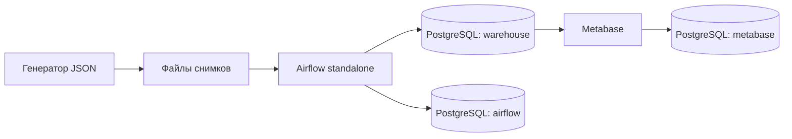

# Участник 4: Docker Compose и запуск окружения

## Ответственность

Поднять PostgreSQL, Airflow и Metabase, настроить связи, хранение данных и локальный доступ к интерфейсам. Подготовить инструкции запуска, остановки и диагностики для остальных участников.

## Что реализовано

- `compose.yaml`: три контейнера и внутреннее соединение сервисов.
- `scripts/init-postgres.sh`: три базы, владельцы и BI-роль, схема warehouse.
- `scripts/configure.py`: индивидуальные секреты, сохранение существующих паролей.
- `.env.example`: список параметров без рабочих секретов.
- `dags/orders_pipeline.py`: пять задач Airflow с последовательными зависимостями.
- `README.md`: команды запуска и адреса интерфейсов.

## Взаимодействие



Airflow использует PostgreSQL для метаданных и отдельно подключается к warehouse. Metabase хранит свою конфигурацию в базе `metabase`, а аналитические запросы выполняет ролью `bi_reader` к `warehouse`. Все три базы находятся в одном сервисе PostgreSQL, но имеют разных владельцев.

## Ресурсы и доступ

| Сервис | Версия | Лимит памяти | Порт на ВМ |
|---|---|---|---|
| PostgreSQL | 17.11 | 512 МиБ | 127.0.0.1:15432 |
| Airflow | 3.3.2, Python 3.12 | 3 ГиБ | 127.0.0.1:8080 |
| Metabase | 0.64.1 | 1,5 ГиБ | 127.0.0.1:3333 |

Это учебное окружение с Airflow standalone. Рабочие базы и журналы сохраняются в Docker volumes. Наличие тома PostgreSQL означает, что init-скрипт выполняется только при первом запуске пустого тома. Изменение `.env` позже само по себе не меняет пароли существующих ролей БД.

## Команды для демонстрации

```bash
sudo docker compose ps
sudo docker stats --no-stream
sudo docker compose exec -T airflow airflow dags list-import-errors -o json
sudo docker compose exec -T airflow airflow dags trigger orders_pipeline
sudo docker compose exec -T airflow airflow dags list-runs orders_pipeline -o json
sudo docker compose logs --tail 80 airflow
sudo docker compose logs --tail 80 metabase
```

Показать зелёные задачи DAG, доступ к интерфейсам по локальным адресам и повторный запуск без новых дубликатов. Остановку всего проекта выполнять только после окончания демонстрации. Команды `stop` и `start` сохраняют данные.

## Отличие от сборки преподавателя

В преподавательской сборке Airflow и PostgreSQL объединены в контейнере `de-pg-cr-af`; Metabase работает отдельно и подключается к нему по сети Compose. В нашем варианте они разделены на три контейнера. Поток STG → DDS → CDM → BI сохранён. README преподавателя предлагает сборку, но обязательность использования именно этого образа в прочитанных материалах не указана.
