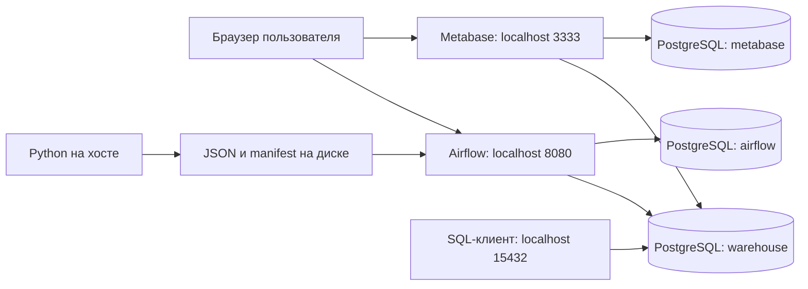
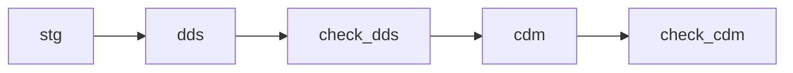

# Участник 4: Docker Compose и запуск окружения

Ваша часть — обеспечить работающие PostgreSQL, Airflow и Metabase, объяснить их связи, хранение данных и порядок диагностики. Остальные участники должны получить один согласованный набор и понятный способ выполнить свои команды.

Начните с [общего порядка работы](README.md). Эта инструкция описывает локальный запуск на устройстве, где работает Docker. Рабочие пароли создаются на этом устройстве; они не хранятся в GitHub.

## Методичка терминов

| Термин | Объяснение | Пример в проекте |
| --- | --- | --- |
| Docker | Средство запуска приложений в контейнерах | Три сервиса лабораторной |
| Образ, image | Подготовленное содержимое для создания контейнера | `postgres:17.11-bookworm` |
| Контейнер | Запущенный экземпляр приложения из образа с заданными настройками | PostgreSQL с подключённым томом |
| Docker Engine | Служба, которая создаёт и запускает контейнеры | В Linux обычно работает как системная служба |
| Docker Desktop | Приложение для работы с Docker на Windows/macOS | Для стенда используется режим Linux containers |
| Compose | Описание и управление несколькими сервисами | `compose.yaml` |
| Сервис Compose | Именованный компонент окружения | `postgres`, `airflow`, `metabase` |
| Compose-проект | Группа контейнеров, сети и томов с общим именем | `orders-lab`; имя другого набора сохраняется в `.env` |
| Внутренняя сеть | Сеть, через которую общаются контейнеры проекта | Airflow обращается к `postgres:5432` |
| Публикация порта | Связь порта хоста с портом контейнера | `127.0.0.1:15432:5432` |
| Localhost | Машина или контейнер, из которого сделано обращение | `localhost` внутри Airflow означает сам контейнер Airflow |
| Volume, том | Хранилище данных, управляемое Docker | `pgdata`, `airflowlogs` |
| Bind mount | Подключение файла или папки хоста в контейнер | `./dags → /opt/airflow/dags` |
| `:ro` | Подключение файлов только для чтения | Код и исходные JSON нельзя изменить из контейнера |
| Переменная окружения | Настройка, переданная процессу | `WAREHOUSE_DSN`, `DATASET_MANIFEST` |
| `.env` | Локальный файл значений для настройки Compose | Индивидуальные пароли и выбранный manifest |
| DSN | Описание подключения к БД | Пользователь, пароль, адрес и имя базы |
| Healthcheck | Команда проверки готовности сервиса | `pg_isready` или HTTP-запрос |
| Лог | Записи процесса о событиях и ошибках | Журнал неудачной задачи Airflow |
| Airflow | Планирование и исполнение зависимых задач | `orders_pipeline` |
| DAG | Направленный граф задач без циклов | STG → DDS → проверка → CDM → проверка |
| Task | Одна задача в DAG | `dds` обрабатывает снимки своего этапа |
| DAG run | Один запуск всего графа | Запуск с уникальным `run_id` |
| Retry | Повтор задачи после ошибки | У загрузок разрешён один повтор через 10 секунд |
| Executor | Способ исполнения задач Airflow | `LocalExecutor` запускает задачи в окружении Airflow |
| Standalone | Команда учебного запуска компонентов Airflow вместе | Один контейнер с `airflow standalone` |

`healthy` подтверждает штатную проверку конкретного сервиса. Для готовности всей работы дополнительно нужны успешный DAG, заполненные слои и сверки данных. Запущенный контейнер сам по себе не подтверждает правильность показателей.

## Схема взаимодействия сервисов



Три нарисованные базы находятся в **одном** сервисе PostgreSQL. Airflow хранит в базе `airflow` состояния запусков и задачи; Metabase в `metabase` хранит вопросы, дашборды и настройки. Бизнес-данные находятся в `warehouse`, в схемах `ops`, `stg`, `dds`, `cdm`.

Генератор запускается Python на хосте **до DAG**. Папка с JSON монтируется в Airflow; задачи читают её и записывают слои. Metabase подключается к warehouse ролью `bi_reader` для чтения CDM.

## Файлы, которые нужно разобрать

| Файл | Назначение |
| --- | --- |
| [compose.yaml](../../compose.yaml) | Образы, сеть, порты, лимиты, переменные, тома и проверки готовности |
| [configure.py](../../scripts/configure.py) | Выбор manifest, индивидуальные секреты и сохранение настроек |
| [init-postgres.sh](../../scripts/init-postgres.sh) | Первичная настройка ролей, трёх БД и схем warehouse |
| [01_warehouse.sql](../../sql/01_warehouse.sql) | Структура бизнес-хранилища |
| [start.sh](../../scripts/start.sh), [start.ps1](../../scripts/start.ps1) | Полный запуск, настройка BI и проверки |
| [orders_pipeline.py](../../dags/orders_pipeline.py) | Зависимости пяти задач Airflow |
| [.env.example](../../.env.example) | Состав локальных настроек без рабочих значений |
| [.gitignore](../../.gitignore) | Исключение секретов, кэша и новых локальных наборов из Git |

## Шаг 1. Проверить устройство

Нужны Git, Python 3.9 или новее, Docker с Compose. Для Windows/macOS предварительно запустите Docker Desktop. Образы скачиваются из интернета при первом запуске. Выделите Docker около 5 ГиБ памяти и несколько гигабайт диска для образов и БД.

```bash
python3 --version
docker version
docker compose version
docker info
```

В Windows Python может называться `python`. Если Docker на Linux требует sudo, применяйте его к командам Docker. `start.sh` поддерживает доступ через `sudo -n docker`, когда sudo не требует интерактивного ввода пароля. Ошибка доступа к Docker должна быть устранена до запуска стенда.

| Сервис | Образ | Лимит памяти | Порт хоста |
| --- | --- | --- | --- |
| PostgreSQL | `postgres:17.11-bookworm` | 512 МиБ | `127.0.0.1:15432` |
| Airflow | `apache/airflow:3.3.2-python3.12` | 3 ГиБ | `127.0.0.1:8080` |
| Metabase | `metabase/metabase:v0.64.1` | 1,5 ГиБ | `127.0.0.1:3333` |

Лимит — верхняя граница потребления контейнера, а не объём, обязательно занятый им сразу. Свободная память нужна также ОС и другим программам.

## Шаг 2. Выполнить полный запуск

Linux/macOS:

```bash
git clone https://github.com/PfLoLexe/ppad-orders-airflow-lab.git
cd ppad-orders-airflow-lab
bash scripts/start.sh
```

Windows, PowerShell:

```powershell
git clone https://github.com/PfLoLexe/ppad-orders-airflow-lab.git
cd ppad-orders-airflow-lab
powershell.exe -NoProfile -ExecutionPolicy Bypass -File .\scripts\start.ps1
```

Скрипт последовательно:

1. Проверяет доступ к Docker и генерирует выбранные снимки.
2. Передаёт путь manifest в `configure.py`; создаёт `.env` и `private/passwords.json` при первом запуске.
3. Проверяет конфигурацию Compose, запускает контейнеры и ждёт их healthcheck.
4. Ждёт регистрации DAG, запускает его и ожидает `success`.
5. Настраивает Metabase, сверяет warehouse и BI.

При первой инициализации PostgreSQL создаёт роли и базы; схема warehouse применяется после `SET ROLE warehouse`. Успешный init зависит от **пустого** тома PostgreSQL. Последующие старты используют сохранённую БД.

Не копируйте `.env.example` с паролями `replace` вместо генерации настроек. Не меняйте manifest на другой набор в заполненном warehouse. Для другого объёма создайте отдельную копию с отдельным именем проекта по [инструкции](../scaling.md).

## Шаг 3. Проверить сервисы и DAG

```bash
docker compose ps
docker compose exec -T airflow airflow dags list-import-errors -o json
docker compose exec -T airflow airflow dags list-runs orders_pipeline -o json
docker stats --no-stream
```

Ожидается три работающих сервиса с `healthy`, отсутствие ошибок импорта DAG и успешный запуск `orders_pipeline`. Скрипт полного запуска также должен завершиться без ошибки. Контрольные отчёты находятся в `reports/warehouse-verification.json` и `reports/bi-verification.json`.



Расписание DAG отключено (`schedule=None`), запуск ручной. Один запуск каждой загрузки обрабатывает все дневные снимки по порядку. Автоматически по календарю новые заказы не создаются. `max_active_runs=1` ограничивает одновременные запуски DAG, а настройки контейнера ограничивают число одновременно выполняемых задач.

Повторный запуск:

```bash
docker compose exec -T airflow airflow dags trigger orders_pipeline
docker compose exec -T airflow airflow dags list-runs orders_pipeline -o json
```

Дождитесь `success` у нового запуска. Завершённые этапы дней пропускаются по журналу, поэтому повтор того же набора не создаёт дубликаты. Ошибку в исходнике сам retry не исправляет; выясните причину в журнале задачи.

## Шаг 4. Передать подключения участникам

| Назначение | Логин | Где найти пароль | Адрес на устройстве с Docker |
| --- | --- | --- | --- |
| Интерфейс Airflow | `admin` | `AIRFLOW_PASSWORD` в `.env` | http://localhost:8080 |
| Интерфейс Metabase | `admin@orders-lab.invalid` | `METABASE_ADMIN_PASSWORD` | http://localhost:3333 |
| Бизнес-БД | `warehouse` | `WAREHOUSE_PASSWORD` | `127.0.0.1:15432`, БД `warehouse` |
| Аналитическое чтение | `bi_reader` | `BI_PASSWORD` | Та же БД, чтение CDM |

В SQL-клиенте задайте PostgreSQL, host `127.0.0.1`, port `15432`, database `warehouse`, нужные логин и пароль. Административный пользователь PostgreSQL — `postgres`, его пароль хранится в `POSTGRES_PASSWORD`; обычным загрузкам он не нужен.

Внутри Compose PostgreSQL доступен как `postgres:5432`. Airflow и Metabase используют именно этот адрес, а не опубликованный порт 15432. `localhost` внутри каждого контейнера относится к нему самому. Адреса таблицы выше работают на устройстве, где поднят стенд; они не означают публичный доступ к удалённой ВМ.

Пользователь веб-интерфейса Airflow и роль БД `airflow` — разные учётные записи. Аналогично отличаются администратор Metabase, служебная роль `metabase` и аналитическая роль `bi_reader`. Рабочие секреты передавайте отдельно от публичной документации.

## Шаг 5. Объяснить хранение и остановку

| Что сохраняется | Где |
| --- | --- |
| Все три БД PostgreSQL | Именованный том `pgdata` проекта |
| Журналы задач Airflow | Именованный том `airflowlogs` |
| Исходники, DAG, SQL, JSON | Папки проекта на хосте; подключены для чтения |
| Отчёты сверок | `reports/` на хосте; Airflow может туда записывать |
| Пароли и авторизация | `.env` и `private/` на хосте |

```bash
docker compose stop
docker compose start
```

`stop` останавливает контейнеры, `start` запускает их снова. `docker compose down` удаляет контейнеры и сеть, сохраняя именованные тома; после него окружение создают через `docker compose up -d`, а не `start`. Добавление `--volumes` удаляет тома БД и журналов: для обычной остановки его не используйте.

После удаления и пересоздания контейнеров данные сохранятся при том же имени Compose-проекта и тех же томах. Изменение пароля в `.env` само по себе не меняет роль существующей БД. Изменение DDL требует миграции или отдельной новой БД; init-скрипт не применяется заново к заполненному тому.

## Диагностика по симптомам

| Симптом | Что проверить и как продолжить |
| --- | --- |
| Docker недоступен | `docker info`; запуск Engine/Desktop и права пользователя |
| Порт занят | Другой стенд или приложение на 8080, 3333, 15432; остановить конфликтующий экземпляр |
| PostgreSQL не готов | `docker compose logs --tail 80 postgres`; ошибки инициализации и состояние тома |
| Airflow не регистрирует DAG | `list-import-errors`; файл в `dags/`, монтирование и журнал Airflow |
| DAG имеет `failed` | Открыть неудачную задачу в Airflow и прочитать её лог; проверить предшествующий слой |
| Metabase не открывается | `docker compose ps`, его журнал и свободную память; первая инициализация требует времени |
| Сервис перезапускается | Его журнал, `docker stats --no-stream`, свободную память устройства |
| БД отвергает новый пароль | Сверить `.env` с настройками существующих ролей; восстановить настройки или явно сменить пароль в БД |
| Новый набор отклонён | Проверить manifest и имя проекта; использовать отдельные тома по инструкции объёма |

```bash
docker compose logs --tail 80 postgres
docker compose logs --tail 80 airflow
docker compose logs --tail 80 metabase
```

Не публикуйте полный вывод `docker compose config` с подставленными значениями `.env`: он может содержать секреты. Для проверки структуры без вывода значений используйте `docker compose config --quiet`.

## Готовность и вопросы для защиты

Передайте адреса, локальные настройки и порядок команд; покажите три здоровых сервиса, успешный DAG и отчёты сверок. Объясните, какие данные остаются после остановки.

1. Чем образ отличается от контейнера?
2. Почему три приложения не означают три сервиса PostgreSQL?
3. Где Airflow хранит состояния задач и где находятся заказы?
4. Чем порт хоста 15432 отличается от порта контейнера 5432?
5. Что сохраняют volume и bind mount?
6. Почему смена `.env` не переинициализирует PostgreSQL?
7. Что проверяет healthcheck и чего он не подтверждает?

Linux-запуск и расчёты проверены на ВМ; сведения о проверках находятся в [отчёте](../../reports/verification.md). PowerShell-скрипт подготовлен, но выполнение на Windows отдельно не проверялось. У преподавателя Airflow и PostgreSQL объединены в одном контейнере; в нашей утверждённой реализации сервисы разделены, при этом цепочка STG → DDS → CDM → BI сохранена.
