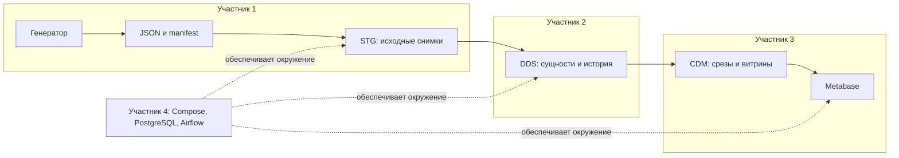

# Методические инструкции для четырёх участников

Эти материалы помогают разобраться в готовом стенде, проверить свою часть и объяснить её на защите. В каждой инструкции есть словарь терминов, схема, порядок действий, проверочные запросы и вопросы для самопроверки. Распределение ролей описывает ответственность за проект; оно не подтверждает личное авторство конкретного студента.

## С чего начать

1. Прочитайте [предметную область](../domain.md): что считается заказом, продажей и отменой.
2. Участник 4 запускает стенд по [README](../../README.md). Остальные получают работающие контейнеры и выбранный набор данных.
3. Откройте инструкцию своей роли и пройдите шаги по порядку. На уже заполненном стенде команды загрузки проверяют повтор, а не создают новую историю.
4. Сверьте результаты между ролями и подготовьте общий показ одного заказа от JSON до дашборда.

| Роль | Инструкция | Что передаёт дальше |
| --- | --- | --- |
| 1 | [Источник и STG](01-source-stg.md) | Manifest, формат снимков, идентификаторы и правила изменений |
| 2 | [DDS и история](02-dds.md) | Связанную модель, историю товаров и статусов, правила среза |
| 3 | [CDM и BI](03-cdm-bi.md) | Витрины, определения показателей, дашборд и результаты сверок |
| 4 | [Окружение](04-environment.md) | Запущенные сервисы, адреса, настройки и порядок диагностики |

## Общая схема взаимодействия



Airflow запускает загрузчики по зависимостям. PostgreSQL хранит STG, DDS и CDM в базе `warehouse`; служебные данные Airflow и Metabase находятся в других базах того же сервиса PostgreSQL. Metabase выполняет аналитические запросы ролью `bi_reader` только к CDM.

## Как читать команды

Все команды выполняются из корня клонированного репозитория. `docker compose` должен видеть `compose.yaml` и созданный `.env`. Если на Linux Docker доступен только через sudo, добавляйте `sudo` перед `docker`; на Windows и macOS этого делать не нужно.

Команды Python на хосте не обращаются к БД, если в них явно не запускается проверка BI или настройка Metabase. Загрузчики запускаются **в контейнере Airflow**: там есть `psycopg2`, переменные подключения и доступ к внутренней сети.

SQL-блоки выполняйте в консоли PostgreSQL:

```bash
docker compose exec postgres psql -U postgres -d warehouse
```

Это административная консоль для учебных проверок внутри контейнера. Логин `postgres` здесь отличается от роли `warehouse`, которой пользуется загрузчик. Настройки подключения из внешнего SQL-клиента описаны в инструкции участника 4. Для выхода из psql используйте `\q`; команда `\dt dds.*` показывает таблицы DDS.

В PowerShell используйте `python`, если Python установлен под этим именем. Общие команды `docker compose` и запросы в интерактивной консоли psql подходят и для PowerShell.

## Порядок совместной проверки

| Этап | Что показать | Кто объясняет |
| --- | --- | --- |
| Окружение | Три контейнера, `healthy`, успешный DAG | 4 |
| Источник | Один дневной JSON, manifest, сумму позиций | 1 |
| Детальная модель | Связи, версии товара 1, цену покупки и статусы заказа 1 | 2 |
| Аналитика | Последний срез, карточки, графики, влияние фильтров | 3 |
| Повтор | Успешный повтор DAG без новых строк для обработанного набора | Все |

Стандартный набор содержит 1 000 заказов за 30 дней. При изменении объёма контрольные числа отличаются; пользуйтесь manifest своего набора и локальными отчётами. Порядок создания другого набора описан в [инструкции по объёму](../scaling.md). Не заменяйте manifest в уже заполненном warehouse.

## Что сдавать и как готовиться

В качестве материалов используйте исходники своей части, схемы, объяснение алгоритма, результаты проверок и общий дашборд. Не включайте рабочие пароли или приватные ключи в отчёт. Точные критерии оценивания из плана занятий не предоставлены; перечень выше помогает объяснить реализацию и не заменяет рубрику преподавателя.

Проверьте, что можете ответить на три общих вопроса: откуда пришла цифра на дашборде; как восстановить состояние на прошлую дату; что произойдёт при повторном запуске или ошибке в одном дне.
