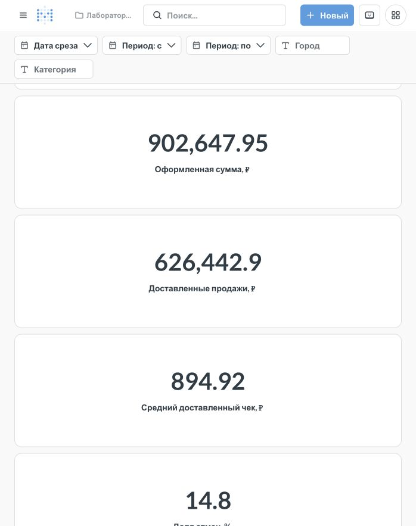

# Проверки стенда и сценарий защиты

Дата проверки: 10 октября 2026 года. Среда: Ubuntu 24.04 на ВМ. Linux-скрипт полного запуска проверен на этой ВМ; Windows-скрипт подготовлен отдельно и на Windows не выполнялся.

## Проверки данных

| Проверка | Результат |
|---|---|
| Восемь тестов генератора и настройки | Пройдены |
| Сверка всех 30 исторических срезов с JSON | Пройдена: статусы, суммы, число и состав позиций |
| Повтор STG → DDS → CDM | Контрольные отпечатки таблиц и журнала этапов сохраняются |
| Ошибка после создания новой товарной версии | Пакет полностью откатывается; данные таблиц сохраняются |
| Интервалы истории DDS | Пересечений нет; текущие версии уникальны |
| Сохранение цены покупки | Заказ 1 сохраняет 69,00 ₽ для товара 1 |
| История товара 1 | Три версии: 69,00 → 75,90 → 65,55 ₽ |
| Запросы Metabase | Все 12 вопросов выполняются |
| Независимые проверки BI | 28 сверок для четырёх сочетаний фильтров |
| Доступ BI к DDS | Отклонён PostgreSQL: `permission denied for schema dds` |
| Интерфейс Metabase | Дашборд просмотрен в браузере; карточки, графики и таблица отображаются |

Четыре сценария BI: последний срез без фильтров; срез в середине периода; город и категория с ограничением периода; пустой период после последнего снимка. Даты выбираются по manifest, поэтому проверка подходит для разных периодов. Проверяются шесть карточек и агрегаты продаж по категориям. Это проверка расчётов, а не только ответов HTTP.

Подробности: `warehouse-verification.json`, `bi-verification.json`, `metabase-results.json`. Отпечатки таблиц относятся к экземпляру, на котором выполнена проверка; служебные идентификаторы и времена загрузки на новом устройстве могут отличаться.

## Контрольные значения на 30 сентября 2026 года

Без фильтра города, категории и периода:

| Показатель | Значение |
|---|---:|
| Оформленные заказы | 1 000 |
| Оформленная сумма | 902 647,95 ₽ |
| Доставленные заказы | 700 |
| Доставленные продажи | 626 442,90 ₽ |
| Средний доставленный чек | 894,92 ₽ |
| Доля отмен | 14,80% |
| Средний срок доставки | 105,89 ч |

Остальные заказы могут ещё находиться в промежуточных состояниях на конце периода. Генератор не требует завершения всех заказов к последнему срезу.

## Проверка увеличенного набора

В отдельном Compose-проекте с пустыми томами проверены 10 000 заказов, 1 000 покупателей, 30 товаров за 12 дней с 1 августа 2026 года, seed 7. DAG завершился успешно за 110,79 секунды. Сверены все 12 срезов, повторная загрузка, откат ошибочного пакета и 28 расчётов BI; ограничения доступа BI также подтверждены. В скрипте BI исправлено пересечение имени переменной с типом даты; после исправления сверки повторно прошли на обоих наборах.

Результаты — в [volume-verification.json](volume-verification.json). Этот замер относится к конкретному запуску на ВМ; время на другом устройстве или за другой период может отличаться. Тестовые контейнеры и тома удалены после проверки; основной стенд сохранён.

## Что показать на защите

1. Участник 4 открывает `docker compose ps`, объясняет три контейнера, служебные базы, сеть и лимиты; показывает успешный DAG.
2. Участник 1 показывает каталог, один JSON и манифест; объясняет seed, ФИО, рубли и полные накопительные снимки.
3. Участник 2 показывает ER-схему, внешние ключи, три версии товара 1 и сохранённую цену позиции заказа 1; объясняет 3НФ и интервалы истории.
4. Участник 3 показывает контрольные значения и графики Metabase; меняет срез и фильтры, открывает детализацию заказов; объясняет даты оформления и доставки.
5. Совместно запускают DAG повторно и демонстрируют отчёт об идемпотентности и откате ошибочного пакета.

## Ограничения проверки

Первый технический запуск до исправления авторизации Airflow завершился ошибкой; он сохранён в истории. Последующие успешные запуски и отдельная проверка с пустыми базами фиксируются в `runtime.json` и `fresh-start.json`.

Точные критерии оценивания из плана занятий не предоставлены. Проверки подтверждают заявленную реализацию; соответствие неизвестной рубрике не утверждается. Реальные продажи, возвраты, платежи и склад в модель не входят.

## Дашборд

